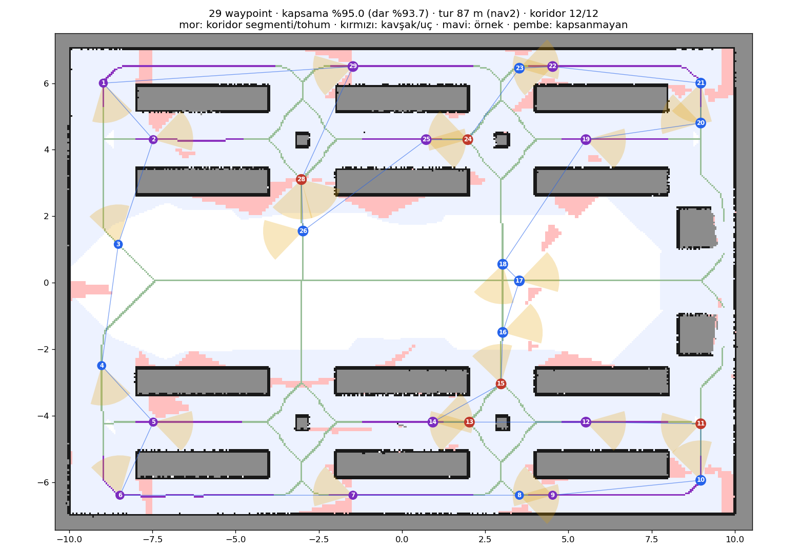
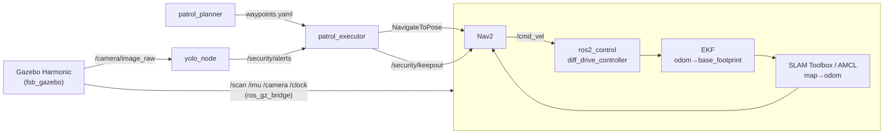
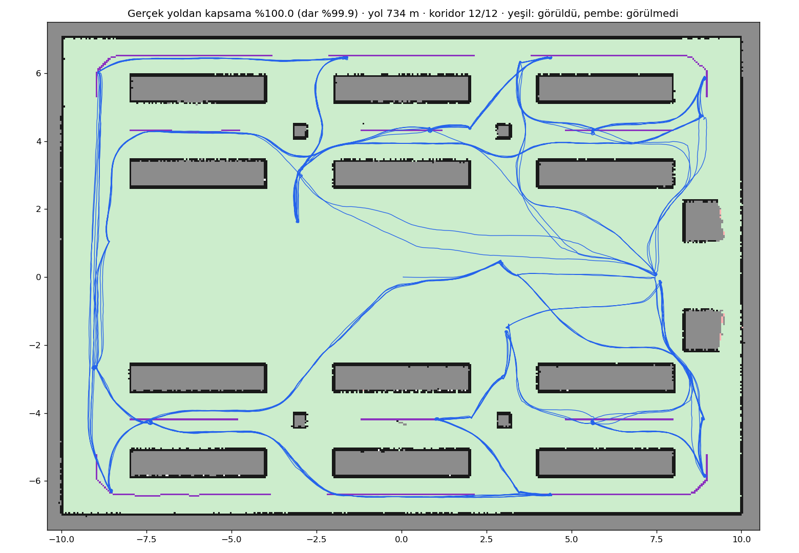

# Factory Security Patrol Robot (ROS 2 Jazzy · Gazebo Harmonic)

**English** · [Türkçe](README.md)

[](https://github.com/sinann-emree/factory_security_bot_ws/actions/workflows/ci.yml)


A differential-drive security robot that patrols a factory floor autonomously, generates its patrol
route from the map, and raises an alert when it finds a **person lying on the floor**. Everything
runs in simulation today; the control stack is built so that the real robot (Andino-class
hardware, planned) uses the same software with a different ros2_control hardware plugin.

<!-- Demo: replace with a recording, e.g. media/demo.gif (patrol in RViz + Gazebo) -->
> **Demo:** _video/GIF placeholder — `media/demo.gif` (to be recorded)._



**Contents:** [Developed in this project](#developed-in-this-project) ·
[Open-source components](#open-source-components) · [Architecture](#architecture) ·
[Results](#results-simulation) · [Install](#install) · [Run](#run) · [Status](#status) ·
[Documentation](#documentation) · [License](#license)

---

## Developed in this project

All `fsb_*` packages were written for this project. Known methods are named; the work is in how
they are combined, parameterised and tested here — no new algorithm is claimed.

| Package / component | What it does | Design decisions |
|---|---|---|
| **`fsb_description`** — robot model | URDF/xacro with every physical parameter in one file; sim/real ros2_control plugin chosen by `use_sim` | `test_params_consistency.py` fails the build if wheel radius/separation differ between URDF and controller, if the LiDAR is not rotated 180°, if a sensor `frame_id` does not match its link, or if an inertia matrix is invalid |
| **`fsb_control`** — control config | `diff_drive_controller`, EKF (wheel odometry + IMU yaw rate), speed limits | One owner per TF (`odom→base_footprint` only from the EKF); 0.2 m/s limit derived from the motor budget (`docs/HARDWARE.md`) |
| **`cmd_vel_watchdog`** (`fsb_control`) | Publishes zero velocity when commands stop | Needed when perception runs off-board; 0.50–0.52 s reaction in 10/10 trials |
| **`patrol_planner`** (`fsb_patrol`) | Map → patrol waypoints, no hand-placed coordinates | This project's implementation of medial-axis skeleton (Zhang–Suen thinning, an approximation of the generalised Voronoi diagram), viewpoint coverage as greedy **set cover** with camera FoV ray casting, mandatory waypoints in corridor segments, and **TSP** ordering (Held–Karp for n ≤ 12, otherwise nearest neighbour + 2-opt + Or-opt) |
| **`patrol_executor`** (`fsb_patrol`) | Runs the patrol through Nav2 | Greedy idleness rule (`weight · waiting time − travel time`), skip-and-continue on unreachable goals |
| **Incident handling** (`fsb_patrol`) | Lying person → map position from LiDAR, persistent incident list, recording from 3 viewpoints, Nav2 keep-out zone, revisit | Entries are removed only when the camera view and LiDAR both confirm the spot is empty; otherwise they are kept and retried |
| **`coverage_monitor`** (`fsb_patrol`) | Coverage actually seen along the driven path | Same visibility model as the planner, so plan and result are comparable |
| **`yolo_node`** (`fsb_perception`) | YOLOv8n-pose + posture rules (torso axis, box aspect), M-of-N temporal check | Alerts only for lying people; runs in a worker thread, only on the latest frame; can run on another machine with compressed images |
| **Measurement tools** (`fsb_gazebo/scripts`) | Ground-truth clearance, odometry/drift, LiDAR mounting check, map quality vs. world, AMCL convergence, recovery counter, RTF/CPU profiler, posture statistics | Every number in the results table comes from one of these scripts |
| **World generator** (`generate_factory_world.py`) | Parametric 20 × 14 m factory world with optional people/boxes | Output is byte-identical to the committed SDF files |

## Open-source components

The project is built on: **ROS 2 Jazzy**, **Gazebo Harmonic** with `ros_gz` and `gz_ros2_control`,
**ros2_control** (`diff_drive_controller`), **Nav2** (Smac planner, Regulated Pure Pursuit, AMCL,
velocity smoother, collision monitor), **SLAM Toolbox**, **robot_localization**, **Ultralytics
YOLOv8** (AGPL-3.0), Gazebo Fuel human models, and the **Andino** robot (Ekumen-OS, BSD-3) as the
reference for dimensions, firmware and chassis. Licences, versions and exactly what was used:
[`ATTRIBUTIONS.md`](ATTRIBUTIONS.md).

## Architecture



Same stack in simulation and on the real robot; only the ros2_control hardware plugin changes
(`gz_ros2_control/GazeboSimSystem` ↔ `fsb_hardware`, planned). Details, TF tree and command
limits: [`docs/ARCHITECTURE.md`](docs/ARCHITECTURE.md).

## Results (simulation)

Gazebo Harmonic, 20 × 14 m factory world, WSL2, 16-core CPU, NVIDIA GPU. Patrol rows were measured
at 0.22 m/s before the limit was lowered to 0.2 m/s (re-check at 0.2 m/s in
[`docs/TESTING.md`](docs/TESTING.md)).

| Area | Metric | Result | Sample / conditions |
|---|---|---|---|
| Real-time factor | RTF during patrol | 0.951 (no perception) · 0.944 (YOLOv8n-pose) · 0.910 (pose + compressed images + watchdog) | 240 s each |
| Odometry | 1 m forward / ±360° turn | 1.0260 m odom = 1.0260 m true; −0.003° / +0.002° | single runs |
| EKF drift | Closed-loop error after random driving | 0.18 cm / +0.11° and 1.08 cm / −0.26° | 2 × 5 min, ~44 m, ~3000° turned |
| Map quality | SLAM map vs. world geometry | median 2.2 cm, p95 5.5 cm, 99.96 % of cells ≤ 10 cm, no double walls | 1 map |
| Localisation | AMCL from a wrong initial pose | +60 cm / 16.5° → 1.2 cm / 0.5° in 7 sim-s | 1 run |
| Planning | Waypoints / planned coverage | 29 waypoints, 95.02 %, 12/12 corridors | factory map + 6 synthetic variants (95.02–95.65 %) |
| Patrol | Idleness patrol | 5/5 loops, 156 visits, 0 skipped, 0 collisions, min clearance 10.5 cm | 5 loops, ~734 m |
| Coverage | Seen along the driven path | 99.95 % (narrow areas 99.94 %) | same 5 loops |
| Detection | Lying people found | 12/12, 1 duplicate entry | 4 worlds × 3 people, 1 loop each |
| Detection | False alerts in negative world | 0 alerts (0 "lying" decisions in 471 frames containing a person) | 1 full loop, 4525 inferences |
| Detection | Single-frame "lying" decision | 55 % at 4.7 cm camera height, 67 % at 60 cm | 2464 frames, 4 Fuel models |

**Limitations:** simulation only; four Fuel human models instead of real people; small sample
sizes for the incident pipeline; the camera is 4.7 cm above the floor (Andino geometry), which
limits single-frame posture accuracy. Each document lists its own limitations.



## Install

Ubuntu 24.04 (tested on WSL2) with [ROS 2 Jazzy](https://docs.ros.org/en/jazzy/Installation/Ubuntu-Install-Debs.html) installed.

```bash
git clone https://github.com/sinann-emree/factory_security_bot_ws.git ~/factory_security_bot_ws
cd ~/factory_security_bot_ws
scripts/install_deps.sh          # apt + rosdep (Nav2, SLAM Toolbox, ros_gz, Gazebo Harmonic, ...); uses sudo
source /opt/ros/jazzy/setup.bash
colcon build                     # --symlink-install is not used in this project
source install/setup.bash
colcon test && colcon test-result --verbose   # or scripts/ci.sh (same steps as CI)
```

`colcon test` covers lint, URDF ↔ controller parameter consistency, Nav2 ↔ controller speed-limit
consistency, posture rules, incident localisation and watchlist, planner results on 7 map variants,
relative paths in planner output and `cmd_vel_watchdog` timeout behaviour. None of it needs Gazebo or
a GPU; details in [`docs/TESTING.md`](docs/TESTING.md).

`scripts/install_deps.sh --check` only verifies dependencies (no sudo). Side effects of the
install mode: system apt packages, `rosdep init` (`/etc/ros/rosdep/`) on first use, rosdep cache in
`~/.ros/rosdep/`.

**Perception (optional, `perception:=true`):**
```bash
scripts/setup_perception_venv.sh   # ~/fsb_venv + ~/yolov8n-pose.pt
# CPU-only torch: TORCH_INDEX=https://download.pytorch.org/whl/cpu scripts/setup_perception_venv.sh
```
Side effects: creates `~/fsb_venv` (`--system-site-packages`), downloads torch (several GB with
CUDA), torchvision and Ultralytics from PyPI, removes `setuptools` from the venv (incompatible with
colcon), downloads `yolov8n-pose.pt` (~6.8 MB). It does not touch `~/.local` or system Python.
Model weights are **not** in this repository. Gazebo downloads the Fuel human models to
`~/.gz/fuel` on first start (internet required once).

## Run

```bash
# Simulation + controllers + EKF
ros2 launch fsb_bringup bringup.launch.py

# Mapping with SLAM Toolbox
ros2 launch fsb_bringup bringup.launch.py localization:=slam rviz:=true

# AMCL + Nav2 + 5-loop idleness patrol
ros2 launch fsb_bringup bringup.launch.py localization:=amcl rviz:=true patrol:=true loops:=5

# Patrol + lying-person detection and incident list
ros2 launch fsb_bringup bringup.launch.py localization:=amcl rviz:=true patrol:=true perception:=true \
    world:=$(ros2 pkg prefix fsb_gazebo)/share/fsb_gazebo/worlds/factory_lying.sdf

# Regenerate waypoints after a map change
ros2 run fsb_patrol patrol_planner --map src/fsb_navigation/maps/factory.yaml \
    --out src/fsb_patrol/config/waypoints_factory.yaml
```

Useful arguments: `headless:=true`, `patrol_mode:=idleness|sequential|random`, `coverage:=true`,
`image_transport:=compressed`, `cmd_vel_watchdog:=true`. Incident files are written to
`~/.ros/fsb_security/` (outside the repository) and reloaded on restart; for a run independent
of earlier runs pass an empty directory: `security_log_dir:=$(mktemp -d)`. Unit tests never touch
this directory (they use pytest `tmp_path`). WSL2: if windows do not open, try
`export LIBGL_ALWAYS_SOFTWARE=1` or `headless:=true`.

## Status

| Done (simulation) | Planned / not yet available |
|---|---|
| Robot model, ros2_control, Gazebo integration | **Real hardware:** `fsb_hardware` interface for the Andino firmware, calibration, sensor drivers (stage 7) |
| Sensors + EKF | **Mission / task manager** (schedules, zones, operator commands) |
| SLAM Toolbox, AMCL, Nav2 | **Remote notifications** (e.g. Telegram or similar) — alerts are currently logged, shown in RViz and saved to disk |
| Map-based patrol planning and idleness patrol | Real-world validation of perception (real people, lighting, higher camera mount) |
| YOLOv8-pose lying-person detection, incident list, revisit | |
| Off-board perception with compressed images, `cmd_vel_watchdog` | |

## Documentation

| Document | Content |
|---|---|
| [`docs/ARCHITECTURE.md`](docs/ARCHITECTURE.md) | Packages, data flow, TF ownership, command limits |
| [`docs/PATROL_PLANNER.md`](docs/PATROL_PLANNER.md) | Planner pipeline, executor, incident handling, results |
| [`docs/PERCEPTION.md`](docs/PERCEPTION.md) | YOLOv8-pose node, posture rules, detection results |
| [`docs/TESTING.md`](docs/TESTING.md) | Test levels, commands, expected and measured values |
| [`docs/HARDWARE.md`](docs/HARDWARE.md) | Intended parts, speed/RPM/torque calculations, motor plans |
| [`docs/firmware.md`](docs/firmware.md) | Andino firmware as an external dependency (Turkish) |
| [`ATTRIBUTIONS.md`](ATTRIBUTIONS.md) | Third-party components and licences |
| `src/*/README.md` | Per-package launch commands and parameters (Turkish) |

## License

Apache-2.0 ([`LICENSE`](LICENSE)). The optional perception node uses Ultralytics YOLO
(AGPL-3.0) at runtime; Ultralytics is not included in this repository. If you plan to distribute a
system with this component or offer it as a network service, review the current licence terms
(AGPL-3.0 or a commercial licence) yourself. This note is not legal advice. See
[`ATTRIBUTIONS.md`](ATTRIBUTIONS.md).

**Author:** Sinan Emre Gülşen — [@sinann-emree](https://github.com/sinann-emree)
