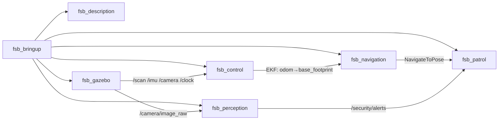
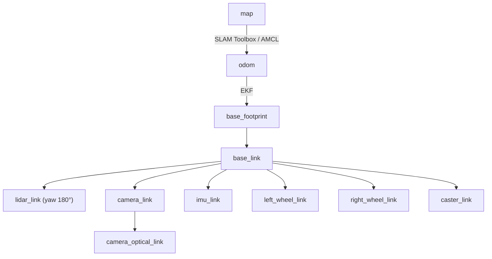

# Fabrika Otonom Güvenlik ve Devriye Robotu


> **English summary.** An autonomous security and patrol robot for factory floors, built on
> ROS 2 Jazzy and Gazebo Harmonic. A differential-drive robot (Andino-class dimensions) with a 360°
> LiDAR, RGB camera and IMU uses ros2_control (identical stack for simulation and real hardware),
> EKF odometry fusion, SLAM Toolbox / AMCL / Nav2, and a patrol planner that generates waypoints
> automatically from the map (medial-axis skeleton + greedy set cover + TSP) and executes them with an
> idleness-based strategy. A YOLOv8-pose node classifies posture and raises an alert only for a
> person lying on the floor; the patrol localises the person on the map with the LiDAR, records them
> from several angles into a persistent incident list, resumes, and later revisits the spot to either
> renew the alert or mark it resolved. Simulation stages 0–6b are complete and verified; the
> real-robot port (stage 7) is planned.

**ROS 2 Jazzy + Gazebo Harmonic tabanlı, fabrika zemininde otonom devriye gezen güvenlik robotu.**


---

## İçindekiler
- [Öne çıkan özellikler](#öne-çıkan-özellikler)
- [Mimari](#mimari)
- [Kurulum](#kurulum)
- [Çalıştırma](#çalıştırma)
- [Durum](#durum)
- [Atıflar](#atıflar)
- [Lisans](#lisans)

---

## Öne çıkan özellikler

Aşağıdaki tüm sayılar simülasyonda (Gazebo Harmonic, 20×14 m fabrika dünyası) ölçülmüştür;
kaynakları geliştirme sırasında alınan ölçümler ve commit geçmişidir.

### Sim/real uyumlu ros2_control mimarisi
- Tek URDF/xacro; `use_sim` argümanı yalnızca donanım eklentisini değiştirir
  (`gz_ros2_control/GazeboSimSystem` ↔ gerçek robot hardware interface). Nav2, SLAM ve devriye katmanı
  iki ortamda da aynıdır.
- Fiziksel parametreler tek kaynakta (`fsb_properties.xacro`); tekerlek yarıçapı 0.0331 m,
  tekerlek ayrımı 0.128 m. `test_params_consistency.py` URDF ↔ `controllers.yaml` uyumunu test eder.
- `joint_state_broadcaster` + `diff_drive_controller` (`cmd_vel` = `TwistStamped`, doğrulandı).
- 1 m ileri komutunda odom 1.0260 m = gerçek 1.0260 m; ±360° dönüşte odom–gerçek farkı
  −0.003° / +0.002°.
- LiDAR 180° dönük monte (`rpy="0 0 π"`); scan hizalama testinde doğru montaj %97.9 / %98.5 inlier,
  yanlış (+180°) varsayım %1.5 / %5.7.

### EKF ile odometri birleştirme
- `robot_localization` EKF: tekerlek odometrisi (vx, vy, vyaw) + IMU (vyaw), 30 Hz.
- `odom → base_footprint` TF'inin **tek** yayıncısı EKF'dir (`enable_odom_tf: false`).
- 5 dk rastgele sürüş drift testi (~44 m, ~3000° toplam dönüş): kapalı çevrim hatası
  0.18 cm / +0.11° ve 1.08 cm / −0.26°.

### SLAM Toolbox + AMCL + Nav2
- SLAM Toolbox ile haritalama; harita kalitesi (dünyaya karşı): dolu hücre → yüzey medyan 2.2 cm,
  p95 5.5 cm, %99.96'sı ≤ 10 cm, çift duvar yok, kapsama %99.1.
- AMCL: +60 cm / 16.5° hatalı ilk pozdan 7.0 sim-saniyede 1.2 cm / 0.5° hataya yakınsama.
- Nav2: SmacPlanner2D global planlayıcı, Regulated Pure Pursuit, velocity_smoother, collision_monitor.
  NavFn 810 waypoint çiftinin 21'inde yol bulamazken SmacPlanner2D 0/810.
- 4 noktalı devriyede 10/10 tur başarılı, 0 kurtarma davranışı; dinamik engel testinde (rotaya
  konan 0.5 m kutu) hedefe ulaşıldı, minimum açıklık 38.8 cm.


### Haritadan otomatik waypoint üretimi (`patrol_planner`)
Kodda hiçbir dünya koordinatı yoktur; girdi yalnızca harita + `robot_params.yaml`.
1. Serbest alan robot yarıçapı + güvenlik payı kadar şişirilir.
2. Medial axis iskeleti (Zhang–Suen inceltme; genelleştirilmiş Voronoi diyagramının ızgara
   yaklaşıklığı) çıkarılır ve kısa dallar budanır; kavşak, uç ve örnek noktalar aday olur.
3. Her koridor segmentine (raf araları) en az bir waypoint zorunlu tutulur.
4. Kamera FOV'u + ışın izleme ile tembel greedy **set cover** (hedef ≥ %95).
5. Costmap/açıklık doğrulaması, ardından Nav2 gerçek yol uzunluklarıyla **TSP**
   (n ≤ 12 Held–Karp, aksi halde çok başlangıçlı NN + 2-opt + Or-opt).

Fabrika haritasında sonuç: **29 waypoint**, planlanan kapsama **%95.02** (dar bölge %93.7, geniş
%98.3), 12/12 koridor segmentine giriş, min açıklık 0.475 m, TSP turu 87.4 m. Döndürülmüş /
aynalanmış / kırpılmış 7 sentetik harita varyantında (Gazebo'suz, `colcon test` içinde) 12–31
waypoint ve %95.02–95.65 kapsama.

Yalnızca apt paketleri kullanılır (`python3-numpy`, `python3-scipy`, `python3-yaml`,
`python3-matplotlib`); scikit-image, networkx ve pip OpenCV bilinçli olarak kullanılmadı.

### Idleness tabanlı devriye (`patrol_executor`)
- Varsayılan mod `idleness`: skor = ağırlık · bekleme süresi − tahmini yol süresi. Ayrıca
  `sequential` (TSP sırası) ve `random` modları.
- Ulaşılamayan hedef atlanır ve loglanır; öncelikli noktalar ayrı yaml'da ağırlıklıdır.
- RViz'de `/patrol/waypoints` MarkerArray ile durum renkleri (hedef / ziyaret / atlandı / bekliyor).
- 5 turluk idleness devriyesi: **5/5 tur eksiksiz**, 156 ziyaret, 0 atlama, 0 kurtarma,
  **0 çarpışma** (ground truth, 528 559 örnek), min açıklık 10.5 cm, ~734 m yol.
  `map→odom` poz sıçraması maks 4.71 cm (p99 1.87 cm).

### Kapsama izleme (`coverage_monitor`)
Robotun gerçek yolundan, simüle kamera görüşüyle kapsamayı ölçer. 5 turluk devriyede gerçek yoldan
kapsama **%99.95** (dar bölge %99.94), 12/12 koridor.


### YOLOv8 ile insan tespiti ve güvenlik alarmı (`fsb_perception`) — Aşama 6 sonucu
> Aşağıdaki "her insanda dur" davranışı Aşama 6b'de değiştirildi: alarm artık yalnızca yerde
> yatan insan için verilir (bir sonraki bölüm). Aşama 6 ölçümleri karşılaştırma için duruyor.

- `yolo_node`: `/camera/image_raw` → `/perception/detections` (`vision_msgs/Detection2DArray`),
  `/perception/image_annotated`; çıkarım ayrı iş parçacığında, ~5.4 Hz (yolov8n, 640×480).
- İnsan ≥ %80 güvenle art arda 3 karede görülünce `/security/alerts`; `patrol_executor` **durur,
  uyarır, olayı kaydeder** (jsonl + işaretli kare) **ve aynı hedefe devam eder**.
- Sim hedefi: Gazebo Fuel "Walking person" (`factory_person.sdf`). Devriye sırasında hedefin
  göründüğü karelerin **%95.1'i ≥ 0.8 güven** (431/453, medyan 0.891).
- Tam tur (YOLO CUDA açık): **30/30 hedef, 0 atlama, 5 alarm** ele alındı; hareket halindeyken
  gelen alarmda robot 0.67 s'de durdu, ~4.5 s bekleyip devam etti.
- Nav2'ye etkisi (240 s devriye, 16 çekirdek; algısız → YOLO CUDA → YOLO CPU): RTF 0.951 → 0.936 →
  0.920; Nav2 CPU %150 → %158 → %164 (tek çekirdek cinsinden); YOLO süreci %68 (CUDA) / %161 (CPU).
- pip OpenCV ↔ `cv_bridge` çakışması `~/.local`'a dokunmadan çözülür
  ([`src/fsb_perception/README.md`](src/fsb_perception/README.md)).

### Yerde yatan insan tespiti ve olay listesi (Aşama 6b)
Alarm **yalnızca yerde yatan insan** içindir; ayakta/yürüyen insan ve hareketli nesneler alarm
üretmez. Akış: YOLOv8-pose duruş sınıflandırma (gövde ekseni + kutu oranı, N karede M) → LiDAR ile
`map` konumu → olay listesi (`watchlist.yaml`) → kişinin çevresinden 3 açıdan kayıt → devriyeye
devam → `revisit_interval` sonra geri dönüp bakma: hâlâ yerde → bildirim yenilenir; yok ve konum
gerçekten görüldü → **çözüldü**; görüş doğrulanamadı → kayıt silinmez, yeniden denenir.
Ayrıntılar: [`src/fsb_patrol/README.md`](src/fsb_patrol/README.md),
[`src/fsb_perception/README.md`](src/fsb_perception/README.md).

**Yakalama** (4 dünya × 3 yatan insan; 4 Fuel modeli, sırtüstü/yüzüstü/yan, farklı konum ve yön):

| Deneme | Tur | Bulunan | Fazla kayıt | Konum hatası, ilk → kayıt sonrası (m) | Kayıt açıları (görüldü/denendi) |
|---|---|---|---|---|---|
| A | 15/30 hedef (dışarıdan kesildi) | 3/3 | 0 | 0.28→0.17 · 0.69→0.25 · 0.36→0.31 | 8/9 |
| B | 30/30 | 3/3 | 1 | 0.15→0.18 · 0.49→0.49 · 0.80→0.65 | 5/8 |
| C (sıkıştırılmış görüntü + watchdog) | 30/30 | 3/3 | 0 | 0.25→0.14 · 0.28→0.10 · 0.20→0.09 | 7/8 |
| D (sıkıştırılmış görüntü + watchdog) | 30/30 | 3/3 | 0 | 0.26→0.23 · 0.80→0.45 · 0.06→0.09 | 6/9 |
| **Toplam** | | **12/12** | **1** | medyan 0.28 → **0.23**, maks 0.80 → 0.65 | **26/34** |

- İlk alarm menzili 1.7–6.3 m (medyan 5.75 m). 12 kişinin 10'u ilk açıda, 11'i ≤ 3 açıda görüldü
  (görülmeyen: Standing person yüzüstü, 0/2 açı). Kayıt karelerinin 446/573'ünde yatan isabet.
- Fazla kayıt: B'de aynı kişi 6.2 m'den görülürken LiDAR kümesi arkadaki raf kenarına kaydı (1.16 m
  hata) ve birleştirme yarıçapının (1 m) hemen dışında kaldı → aynı kişi için 1 ek bildirim.
- **Negatif test** (`factory_negative.sdf`: ayakta insan + kutu, tam tur 30/30): 4525 çıkarım,
  471 insanlı kare (363 ayakta, 108 belirsiz, **0 yatan**), **0 alarm**, 0 kayıt. Sabit düzenekte
  ayakta insan 0/512, kutu 0/192 kare "yatan" sayıldı.
- **Akış** (revisit 150 sim-s): ekle → 3 açı (13/13, 18/18, 17/17 kare) → revisit **hâlâ yerde**
  (doğrulama 1, bildirim 2) → kişi kaldırılıp yerine kutu kondu → 6 açıda "görüş doğrulanamadı",
  **kayıt silinmedi** → kutu kaldırıldı → revisit **ÇÖZÜLDÜ** (0/17 kare; konum FOV'da 2.49 m,
  görüş hattı açık, LiDAR'da konum boş).
- **Kamera yüksekliği:** tek karede doğru "yatan" kararı 4.7 cm'de %55, 60 cm'de %67; gerçek
  robotta kamerayı ≥ 30–60 cm'e almak önerilir.
- **Başarım** (240 s, 16 çekirdek, CUDA): RTF 0.944 (negatif dünya, ham görüntü) / 0.910
  (3 yatan insan, sıkıştırılmış görüntü + watchdog); YOLOv8n-pose %72, Nav2 %157–159, Gazebo
  %225–239 (tek çekirdek cinsinden), GPU %27. Aşama 6: algısız 0.951, YOLOv8n 0.936.
- **Sunucu mimarisi:** JPEG 8.2 KB/kare (ham 0.92 MB), 15.1 Hz; YOLO sıkıştırılmış girdiden
  5.2–5.4 Hz. **`cmd_vel_watchdog`:** bağımsız 10/10 denemede komut kesildikten 0.502–0.519 s
  sonra sıfır hız; turlarda 22 kez devreye girdi (19'u hedefte dururken, 3'ü Nav2 bekleme
  kurtarmasında), 0 hedef atlandı.
- Örneklem küçüktür (4 dünya × 1 tur + akış testleri); sayılar Fuel modelleriyle simülasyon ölçümüdür.
- Gerçek robot için malzeme listesi ve uyumluluk: [`docs/hardware_compat.md`](docs/hardware_compat.md).

---

## Mimari

### Paketler
| Paket | Tür | İçerik |
|---|---|---|
| `fsb_description` | ament_cmake | URDF/xacro, sensörler, `<ros2_control>` (sim/real), RViz |
| `fsb_control` | ament_cmake | `controllers.yaml`, `ekf.yaml`, `cmd_vel_watchdog` (komut kesilince 0.5 s'de dur; gerçek robot hw interface: planlanıyor) |
| `fsb_gazebo` | ament_cmake | `factory.sdf`, `factory_lying.sdf` (yerde yatan insan), `factory_negative.sdf` (ayakta insan + kutu) dünyaları, `gz_bridge.yaml`, sim launch, test/ölçüm betikleri |
| `fsb_navigation` | ament_cmake | SLAM Toolbox, AMCL, Nav2 parametreleri ve launch, kayıtlı harita |
| `fsb_bringup` | ament_cmake | Tek giriş noktası `bringup.launch.py`, RViz konfigürasyonları |
| `fsb_patrol` | ament_python | `patrol_planner`, `patrol_executor` (+ yatan insan olay listesi: konum, çok açılı kayıt, revisit), `coverage_monitor` |
| `fsb_perception` | ament_python | YOLOv8-pose düğümü `yolo_node` (ham ya da sıkıştırılmış görüntü; başka makinede çalışabilir): duruş sınıflandırma, `/perception/detections`, `/perception/posture`, `/security/alerts` (yalnızca yatan insan) |

Her paketin kendi `README.md` dosyasında launch komutları ve parametreler bulunur.



### TF ağacı
Her dönüşümün tek bir sahibi vardır: `map→odom` SLAM Toolbox **veya** AMCL, `odom→base_footprint`
yalnızca EKF.



---

## Kurulum

Hedef ortam: Ubuntu 24.04 (WSL2 üzerinde test edildi), ROS 2 Jazzy, Gazebo Harmonic (gz-sim 8).

```bash
sudo apt update
sudo apt install -y \
  ros-jazzy-ros-gz ros-jazzy-gz-ros2-control \
  ros-jazzy-ros2-control ros-jazzy-ros2-controllers \
  ros-jazzy-navigation2 ros-jazzy-nav2-bringup \
  ros-jazzy-slam-toolbox ros-jazzy-robot-localization \
  ros-jazzy-xacro ros-jazzy-joint-state-publisher-gui \
  ros-jazzy-teleop-twist-keyboard liburdfdom-tools \
  python3-numpy python3-scipy python3-yaml python3-matplotlib \
  ros-jazzy-vision-msgs ros-jazzy-cv-bridge python3-opencv python3-pil python3-psutil
```

YOLOv8 algısı (isteğe bağlı, `perception:=true`) için ayrıca `~/fsb_venv` sanal ortamı ve
`~/yolov8n.pt` gerekir: [`src/fsb_perception/README.md`](src/fsb_perception/README.md).

Depoyu klonlayıp derleyin (`--symlink-install` **kullanılmaz**):

```bash
git clone https://github.com/sinann-emree/factory_security_bot_ws.git ~/factory_security_bot_ws
cd ~/factory_security_bot_ws
source /opt/ros/jazzy/setup.bash
rosdep install --from-paths src --ignore-src -y   # isteğe bağlı: eksik bağımlılıkları tamamlar
colcon build
source install/setup.bash
```

Testler:
```bash
colcon test && colcon test-result --verbose
```

---

## Çalıştırma

Tüm sistem tek launch dosyasından başlar; `use_sim` (varsayılan `true`) `use_sim_time`'ı tüm
düğümlere iletir.

```bash
# Gazebo + controller'lar + EKF
ros2 launch fsb_bringup bringup.launch.py

# Haritalama (SLAM Toolbox)
ros2 launch fsb_bringup bringup.launch.py localization:=slam rviz:=true

# AMCL + Nav2 + 5 turluk idleness devriyesi (tek komut)
ros2 launch fsb_bringup bringup.launch.py localization:=amcl rviz:=true patrol:=true loops:=5

# Devriye + yerde yatan insan tespiti ve olay listesi (~/fsb_venv gerekir, bkz. src/fsb_perception/README.md)
ros2 launch fsb_bringup bringup.launch.py localization:=amcl rviz:=true patrol:=true perception:=true \
    world:=$(ros2 pkg prefix fsb_gazebo)/share/fsb_gazebo/worlds/factory_lying.sdf
```

Sık kullanılan argümanlar: `headless:=true` (yalnızca gz sunucusu), `patrol_mode:=idleness|sequential|random|legacy`,
`coverage:=true`, `map:=<harita.yaml>`. Ayrıntılar: [`src/fsb_bringup/README.md`](src/fsb_bringup/README.md).

Harita değişince waypoint'leri yeniden üretmek için: [`src/fsb_patrol/README.md`](src/fsb_patrol/README.md).

> **WSL2 notu:** Gazebo GUI + RViz pencereleri açılmazsa `export LIBGL_ALWAYS_SOFTWARE=1` deneyin
> veya `headless:=true` ile yalnızca RViz'den izleyin.

---

## Durum

| Aşama | Kapsam | Durum |
|---|---|---|
| 0 | Ortam hazırlığı (ROS 2 Jazzy, Gazebo Harmonic) | ✅ Tamamlandı |
| 1 | Paket iskeletleri (7 `fsb_*` paketi) | ✅ Tamamlandı |
| 2 | URDF/xacro ve ros2_control | ✅ Tamamlandı |
| 3 | Gazebo entegrasyonu, köprü, controller'lar | ✅ Tamamlandı |
| 4 | Sensörler (LiDAR, kamera, IMU) ve EKF | ✅ Tamamlandı |
| 5 | SLAM Toolbox, AMCL, Nav2, waypoint devriyesi | ✅ Tamamlandı |
| 5b | Haritadan otomatik kapsamlı devriye | ✅ Tamamlandı |
| 6 | YOLOv8 ile insan tespiti, `/security/alerts`, devriye tepkisi | ✅ Tamamlandı |
| 6b | Yerde yatan insan: duruş sınıflandırma, harita konumu, olay listesi, revisit | ✅ Tamamlandı |
| 7 | Gerçek robota geçiş (`fsb_hardware`, `use_sim:=false`, kalibrasyon) | 🗓️ **Planlanıyor** |


---

## Atıflar

- [Andino (Ekumen-OS/andino)](https://github.com/Ekumen-OS/andino) — yalnızca robot **ölçüleri ve
  fiziksel parametreler** için referans olarak kullanılmıştır (commit `974264b`). Andino deposundan
  hiçbir dosya kopyalanmamıştır; tüm `fsb_*` paketleri sıfırdan yazılmıştır ve kullanılan her değerin
  kaynağı ilgili dosyada yorum satırıyla belirtilmiştir.
- ROS 2, Gazebo, ros2_control, Nav2, SLAM Toolbox ve robot_localization topluluklarına teşekkürler.

## Yazar

**Sinan Emre Gülşen** — GitHub: [@sinann-emree](https://github.com/sinann-emree)

## Lisans

Bu proje [Apache License 2.0](LICENSE) ile lisanslanmıştır.
