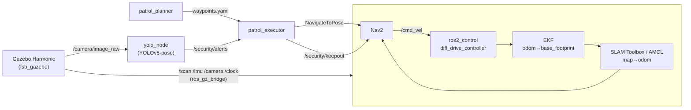

# Fabrika Güvenlik ve Devriye Robotu (ROS 2 Jazzy · Gazebo Harmonic)

[English](README.en.md) · **Türkçe**

[](https://github.com/sinann-emree/factory_security_bot_ws/actions/workflows/ci.yml)


Fabrika zemininde kendi başına devriye gezen, devriye rotasını haritadan kendisi çıkaran ve
**yerde yatan bir insan** gördüğünde alarm veren diferansiyel sürüşlü bir güvenlik robotu. Şu an
her şey simülasyonda çalışıyor. Yazılım, ileride kurulacak gerçek robotun (Andino sınıfı donanım)
aynı yığını yalnızca farklı bir ros2_control donanım eklentisiyle kullanabileceği şekilde kuruldu.


**İçindekiler:** [Mimari](#mimari) · [Ölçülen sonuçlar](#ölçülen-sonuçlar) ·
[Kurulum](#kurulum) · [Çalıştırma](#çalıştırma) · [Test](#test) ·
[Proje yapısı](#proje-yapısı) · [Durum](#durum) · [Sınırlamalar](#sınırlamalar) ·
[Açık kaynak bileşenler ve lisans](#kullanılan-açık-kaynak-bileşenler-ve-lisans)

---

## Mimari



Kısaca akış şöyle:

- **Sürüş ve konum:** Robotu `diff_drive_controller` sürüyor. EKF, tekerlek odometrisini IMU'nun
  yaw hızıyla birleştiriyor. Haritalamada SLAM Toolbox, kayıtlı haritada AMCL konum veriyor. Her TF
  dönüşümünün tek bir yayıncısı var.
- **Devriye noktaları:** `patrol_planner` yalnızca haritaya bakarak noktaları üretiyor. Kullandığı
  bilinen yöntemler:
  - **medial axis** iskeleti (Zhang–Suen inceltme; genelleştirilmiş Voronoi diyagramının ızgara
    yaklaşıklığı),
  - kamera görüş alanıyla **set cover** (açgözlü yaklaşım),
  - **TSP** sıralaması (n ≤ 12 için Held–Karp, daha büyükse en yakın komşu + 2-opt + Or-opt).

  Bunlar yeni algoritmalar değil, bu projedeki uygulamalarıdır.
- **Devriye ve olay takibi:** `patrol_executor` noktaları "en uzun süre bakılmayan yere git"
  (idleness) kuralıyla geziyor. Yatan insan alarmı gelince:
  1. kişiyi LiDAR ile haritada konumluyor,
  2. üç açıdan kayıt alıyor,
  3. kişinin çevresini Nav2'ye yasak bölge olarak bildiriyor,
  4. bir süre sonra geri dönüp yeniden bakıyor.

Ayrıntılar: [`docs/ARCHITECTURE.md`](docs/ARCHITECTURE.md),
[`docs/PATROL_PLANNER.md`](docs/PATROL_PLANNER.md), [`docs/PERCEPTION.md`](docs/PERCEPTION.md).

## Ölçülen sonuçlar

Tüm ölçümler simülasyonda alındı: Gazebo Harmonic, 20 × 14 m fabrika dünyası, WSL2, 16 çekirdek,
NVIDIA GPU. Devriye satırları hız sınırı 0.22 m/s iken ölçüldü. 0.2 m/s ile tekrar koşusu
[`docs/TESTING.md`](docs/TESTING.md)'de.

| Alan | Ölçüm | Sonuç | Örneklem / koşul |
|---|---|---|---|
| Gerçek zaman oranı | Devriye sırasında RTF | 0.951 (algısız) · 0.944 (YOLOv8n-pose) · 0.910 (pose + sıkıştırılmış görüntü + watchdog) | her biri 240 s |
| Odometri | 1 m ileri / ±360° dönüş | odom 1.0260 m = gerçek 1.0260 m; −0.003° / +0.002° | tekil koşular |
| EKF kayması | Rastgele sürüş sonrası kapalı çevrim hatası | 0.18 cm / +0.11° ve 1.08 cm / −0.26° | 2 × 5 dk, ~44 m, ~3000° dönüş |
| Harita kalitesi | SLAM haritası ↔ dünya geometrisi | medyan 2.2 cm, p95 5.5 cm, hücrelerin %99.96'sı ≤ 10 cm, çift duvar yok | 1 harita |
| Konumlama | AMCL, hatalı ilk pozdan | +60 cm / 16.5° → 7 sim-s'de 1.2 cm / 0.5° | 1 koşu |
| Planlama | Nokta sayısı / planlanan kapsama | 29 nokta, %95.02, 12/12 koridor | fabrika haritası + 6 sentetik varyant (%95.02–95.65) |
| Devriye | Idleness devriyesi | 5/5 tur, 156 ziyaret, 0 atlama, 0 çarpışma, en az açıklık 10.5 cm | 5 tur, ~734 m |
| Kapsama | Gidilen yoldan gerçekten görülen alan | %99.95 (dar bölgeler %99.94) | aynı 5 tur |
| Tespit | Bulunan yatan insan | 12/12, 1 fazla kayıt | 4 dünya × 3 kişi, her biri 1 tur |
| Tespit | Negatif dünyada yanlış alarm | 0 alarm (insan görünen 471 karede 0 "yatan" kararı) | 1 tam tur, 4525 çıkarım |
| Tespit | Tek karede doğru "yatan" kararı | kamera 4.7 cm'de %55, 60 cm'de %67 | 2464 kare, 4 Fuel insan modeli |


## Kurulum

ROS 2 Jazzy kurulu bir Ubuntu 24.04 gerekiyor (WSL2'de denendi). ROS 2 kurulumu için:
[resmi kılavuz](https://docs.ros.org/en/jazzy/Installation/Ubuntu-Install-Debs.html).

```bash
git clone https://github.com/sinann-emree/factory_security_bot_ws.git ~/factory_security_bot_ws
cd ~/factory_security_bot_ws
scripts/install_deps.sh          # apt + rosdep: Nav2, SLAM Toolbox, ros_gz, Gazebo Harmonic ... (sudo ister)
source /opt/ros/jazzy/setup.bash
colcon build                     # bu projede --symlink-install kullanılmıyor
source install/setup.bash
```

`scripts/install_deps.sh --check` hiçbir şey kurmadan yalnızca eksikleri denetler (sudo
gerekmez). Kurulum modunun yan etkileri:

- sistem geneline apt paketleri kurar,
- ilk kullanımda `rosdep init` çalıştırır (`/etc/ros/rosdep/` altına yazar),
- `~/.ros/rosdep/` altında rosdep önbelleği oluşturur.

**Algı (isteğe bağlı, `perception:=true`):**
```bash
scripts/setup_perception_venv.sh   # ~/fsb_venv ve ~/yolov8n-pose.pt
# Yalnız CPU için: TORCH_INDEX=https://download.pytorch.org/whl/cpu scripts/setup_perception_venv.sh
```

Betiğin yaptıkları:

- `~/fsb_venv`'i oluşturur (`--system-site-packages`).
- PyPI'dan torch, torchvision ve Ultralytics indirir. CUDA'lı torch birkaç GB tutar.
- colcon ile uyumsuz olduğu için venv'den `setuptools`'u kaldırır.
- `yolov8n-pose.pt` model dosyasını indirir (~6.8 MB). Model ağırlıkları bu repoda **yoktur**.
- `~/.local`'a ve sistem Python'una dokunmaz.

Gazebo, insan modellerini ilk açılışta Fuel'dan `~/.gz/fuel` altına indirir; bunun için bir kez
internet gerekir.

## Çalıştırma

```bash
# Simülasyon + controller'lar + EKF
ros2 launch fsb_bringup bringup.launch.py

# SLAM Toolbox ile haritalama
ros2 launch fsb_bringup bringup.launch.py localization:=slam rviz:=true

# AMCL + Nav2 + 5 turluk devriye
ros2 launch fsb_bringup bringup.launch.py localization:=amcl rviz:=true patrol:=true loops:=5

# Devriye + yerde yatan insan tespiti ve olay listesi
ros2 launch fsb_bringup bringup.launch.py localization:=amcl rviz:=true patrol:=true perception:=true \
    world:=$(ros2 pkg prefix fsb_gazebo)/share/fsb_gazebo/worlds/factory_lying.sdf

# Harita değişince devriye noktalarını yeniden üret
ros2 run fsb_patrol patrol_planner --map src/fsb_navigation/maps/factory.yaml \
    --out src/fsb_patrol/config/waypoints_factory.yaml
```

**Sık kullanılan argümanlar:**

- `headless:=true`
- `patrol_mode:=idleness|sequential|random`
- `coverage:=true`
- `image_transport:=compressed`
- `cmd_vel_watchdog:=true`
- `security_log_dir:=<dizin>`

**Olay kayıtları:** Varsayılan olarak repo dışındaki `~/.ros/fsb_security/` altına yazılır.
Robot yeniden başlatıldığında açık olaylar buradan yüklenir. Önceki koşulardan bağımsız bir deneme
için boş bir dizin verin: `security_log_dir:=$(mktemp -d)`.

**WSL2:** Pencereler açılmazsa `export LIBGL_ALWAYS_SOFTWARE=1` deneyin ya da `headless:=true`
ile çalıştırın.

## Test

```bash
colcon test && colcon test-result --verbose     # ya da: scripts/ci.sh (CI ile aynı adımlar)
```

`colcon test` şunları kapsıyor:

- lint (flake8, pep257, xmllint),
- URDF ↔ controller parametre tutarlılığı,
- Nav2 ↔ controller hız sınırı tutarlılığı,
- duruş sınıflandırma kuralları,
- yatan insan konumlama ve olay listesi,
- planlayıcının 7 harita varyantındaki sonuçları ve çıktısında mutlak yol olmaması,
- `cmd_vel_watchdog` zaman aşımı.

Hiçbiri Gazebo ya da GPU gerektirmiyor ve hepsi CI'da çalışıyor. Simülasyon ve algı testleri elle
koşuluyor. Komutlar ile beklenen ve ölçülen değerler [`docs/TESTING.md`](docs/TESTING.md)'de.

## Proje yapısı

```
factory_security_bot_ws/
├── src/
│   ├── fsb_description/   URDF/xacro, tek kaynaktan fiziksel parametreler, ros2_control (sim/gerçek)
│   ├── fsb_control/       controller ve EKF ayarları, cmd_vel_watchdog
│   ├── fsb_gazebo/        fabrika dünyaları ve üreticisi, köprü ayarı, ölçüm betikleri
│   ├── fsb_navigation/    SLAM Toolbox, AMCL ve Nav2 ayarları, kayıtlı harita
│   ├── fsb_bringup/       tek giriş noktası bringup.launch.py, RViz ayarları
│   ├── fsb_patrol/        patrol_planner, patrol_executor, olay listesi, coverage_monitor
│   └── fsb_perception/    yolo_node (YOLOv8-pose + duruş kuralları)
├── docs/                  mimari, planlayıcı, algı, test, donanım ve firmware dokümanları (İngilizce)
├── scripts/               kurulum ve CI betikleri
├── media/                 demo kayıtları
└── ATTRIBUTIONS.md        üçüncü taraf bileşenler ve lisanslar
```

Her paketin kendi `README.md` dosyasında launch komutları ve parametreleri var (Türkçe).

## Durum

| Yapıldı (simülasyon) | Planlanan / henüz yok |
|---|---|
| Robot modeli, ros2_control, Gazebo entegrasyonu | **Gerçek donanım:** Andino firmware'iyle konuşan `fsb_hardware` arayüzü, kalibrasyon, sensör sürücüleri ([`docs/HARDWARE.md`](docs/HARDWARE.md)) |
| Sensörler ve EKF | **Görev yöneticisi:** zamanlama, bölgeler, operatör komutları |
| SLAM Toolbox, AMCL, Nav2 (0.2 m/s sınırı) | **Uzaktan bildirim** (ör. Telegram). Alarmlar şimdilik loglanıyor, RViz'de gösteriliyor ve diske yazılıyor |
| Haritadan devriye planlama ve idleness devriyesi | Algının gerçek dünyada doğrulanması (gerçek insanlar, ışık, daha yüksek kamera) |
| YOLOv8-pose ile yatan insan tespiti, olay listesi, yeniden kontrol | |
| Sıkıştırılmış görüntüyle başka makinede algı, `cmd_vel_watchdog` | |
| CI (lint, birim ve planlayıcı testleri) | |

## Sınırlamalar

- **Yalnızca simülasyon:** Sonuçların hiçbiri gerçek robotta ölçülmedi. Gazebo bu makinede gerçek
  zamanın biraz altında çalışıyor (RTF 0.91–0.95); süreler simülasyon saniyesi cinsinden.
- **Tespit:** Sayılar dört Gazebo Fuel insan modelinden geliyor. Gerçek insan, giysi ve ışık
  koşulları denenmedi.
- **Olay örneklemi küçük:** 4 dünya × 1 tur ve birkaç akış testi.
- **Kamera yüksekliği:** Kamera yerden 4.7 cm yüksekte (Andino geometrisi). Bu, tek karede duruş
  doğruluğunu sınırlıyor; gerçek robotta ≥ 30–60 cm öneriliyor.
- **Kapsama modeli:** Planlayıcının kapsama modeli ızgara üzerinde 2B görüş hesabı. Haritada
  olmayan nesnelerin örtmesini hesaba katmıyor.
- **Yaklaşık çözümler:** Set cover ve TSP sezgiseldir. 12'den fazla noktada en iyi çözüm iddiası
  yok.
- **Belgeli sınırlamalar:** Her dokümanın kendi "Known limitations" bölümü var.

## Kullanılan açık kaynak bileşenler ve lisans

Proje şu bileşenlerin üzerine kurulu:

- **ROS 2 Jazzy**
- **Gazebo Harmonic** (`ros_gz` ve `gz_ros2_control` ile)
- **ros2_control**
- **Nav2**: Smac planner, Regulated Pure Pursuit, AMCL, velocity smoother, collision monitor
- **SLAM Toolbox**
- **robot_localization**
- **Ultralytics YOLOv8**
- Gazebo Fuel insan modelleri

Robotun ölçüleri, Arduino Nano firmware'i ve 3B baskı şasisi için
[**Andino**](https://github.com/Ekumen-OS/andino) (Ekumen-OS, BSD-3-Clause, commit `974264b`)
referans alındı:

- **Ölçüler:** Ölçü ve parametreler `fsb_*` paketlerinde sıfırdan yazıldı; her değerin kaynağı
  yorum satırında belirtiliyor.
- **Firmware:** Harici bağımlılık olarak sabit commit'ten derleniyor.
- **Şasi:** STL dosyaları bu repoda değil, yalnızca bağlantısı veriliyor.

Hangi bileşenden ne alındığı, sürümleri ve lisansları: [`ATTRIBUTIONS.md`](ATTRIBUTIONS.md).

**Lisans:** Apache-2.0 ([`LICENSE`](LICENSE)).

**Ultralytics notu:** İsteğe bağlı algı düğümü çalışma zamanında Ultralytics YOLO'yu (AGPL-3.0)
kullanıyor; Ultralytics bu repoda yer almıyor. Bu bileşenle birlikte bir sistem dağıtmayı ya da ağ
üzerinden hizmet olarak sunmayı düşünüyorsanız güncel lisans koşullarını (AGPL-3.0 veya ticari
lisans) kendiniz inceleyin. Bu not hukuki tavsiye değildir.

**Yazar:** Sinan Emre Gülşen — [@sinann-emree](https://github.com/sinann-emree)
