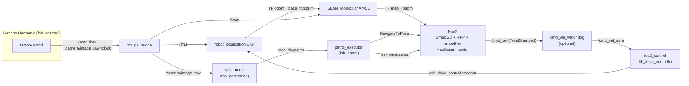
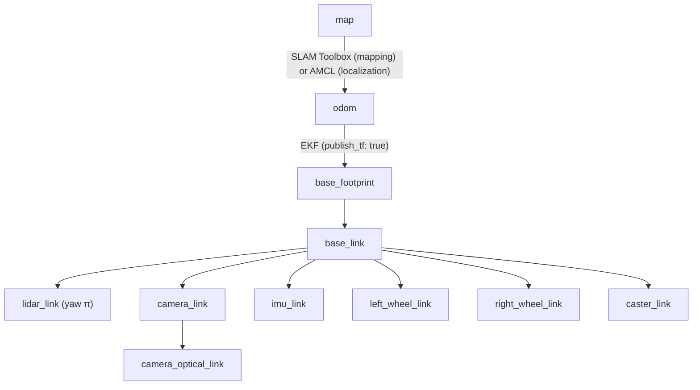

# Architecture

## Design goal

Simulation and the (planned) real robot run **the same control stack**. The only difference is the
ros2_control hardware plugin selected by the `use_sim` xacro argument:

| `use_sim` | Hardware plugin | Clock |
|---|---|---|
| `true` | `gz_ros2_control/GazeboSimSystem` | `/clock` from Gazebo via `ros_gz_bridge` (the only `/clock` source), `use_sim_time:=true` for every node |
| `false` | `fsb_hardware` (planned, stage 7) | wall clock |

Nav2, SLAM Toolbox, AMCL, the EKF, the patrol and the perception nodes are unchanged between the two.
`use_sim_time` is set once in `fsb_bringup/launch/bringup.launch.py` and passed down.

## Packages

| Package | Build type | Content |
|---|---|---|
| `fsb_description` | ament_cmake | URDF/xacro; all physical parameters in one file (`fsb_properties.xacro`); `<ros2_control>` block with sim/real plugin selection; parameter consistency test |
| `fsb_control` | ament_cmake | `controllers.yaml` (`joint_state_broadcaster`, `diff_drive_controller`), `ekf.yaml` (`robot_localization`), `cmd_vel_watchdog` |
| `fsb_gazebo` | ament_cmake | Factory worlds (generated by `generate_factory_world.py`), `gz_bridge.yaml`, sim launch, measurement scripts |
| `fsb_navigation` | ament_cmake | SLAM Toolbox, AMCL and Nav2 parameters and launch files, saved map |
| `fsb_bringup` | ament_cmake | Single entry point `bringup.launch.py`, RViz configurations |
| `fsb_patrol` | ament_python | `patrol_planner`, `patrol_executor` (+ incident handling), `coverage_monitor`, `map_variants` |
| `fsb_perception` | ament_python | `yolo_node` (YOLOv8-pose + posture rules), image compression launch |

Without the watchdog, Nav2's `/cmd_vel` goes directly to the controller.

## TF tree and ownership

Every transform has exactly one publisher; a second publisher of the same transform causes pose
jumps and drift.

- `diff_drive_controller` has `enable_odom_tf: false`; the EKF owns `odom→base_footprint`.
- SLAM Toolbox and AMCL are never launched together (`localization:=slam|amcl|none`).
- The LiDAR is mounted rotated by 180°; the joint has `rpy="0 0 π"` and the Gazebo sensor
  `frame_id` equals the URDF link name. A test enforces both.

## Odometry and drift prevention

Earlier experience with yaw drift and corrupted SLAM maps shaped these choices:

1. Wheel radius (0.0331 m) and separation (0.128 m) are defined once and must match
   `controllers.yaml` exactly; `test_params_consistency.py` fails the build otherwise.
2. Wheel friction and realistic mass/inertia keep wheel slip near zero in simulation.
3. The EKF fuses wheel odometry (vx, vy, vyaw) with IMU yaw rate. IMU orientation is not fused: in
   Gazebo it is effectively ground truth and would hide drift in tests.
4. Mapping uses limited angular speed (scripted mapping tour: 0.15 m/s, ≤ 0.4 rad/s); SLAM Toolbox
   `minimum_travel_distance` / `minimum_travel_heading` are 0.3 m / 0.3 rad.

## Command path and limits

| Layer | Linear | Angular |
|---|---|---|
| RPP `desired_linear_vel` | 0.2 m/s | rotate-to-heading 0.8 rad/s |
| velocity_smoother | ±0.2 m/s, 0.5 m/s² | ±0.8 rad/s, 1.5 rad/s² |
| diff_drive_controller | ±0.2 m/s, 0.5 m/s² | ±1.0 rad/s, 1.5 rad/s² |

The controller limit is the last safety layer. It is read at configure time: changing it at
runtime with `ros2 param set` has no effect (observed), so it is set in the yaml.

`cmd_vel` is `geometry_msgs/TwistStamped` (Jazzy `diff_drive_controller` default, checked with
`ros2 topic info -v`).

## Off-board perception

`yolo_node` depends only on an image topic (no TF, no Nav2), so it can run on another machine.
With `image_transport:=compressed` it consumes JPEG frames (8.2 KB/frame vs. 0.92 MB raw in the
simulation). If the link drops, `cmd_vel_watchdog` on the robot side publishes zero velocity
≈ 0.5 s after the last command.

## Known limitations
- The real-robot hardware interface (`fsb_hardware`) does not exist yet; all results are from
  simulation.
- Gazebo runs below real time on the development machine (RTF 0.91–0.95); all timing values are in
  simulated seconds.
- No mission/task manager or remote notification channel yet: alerts are logged, shown in RViz and
  written to disk.
