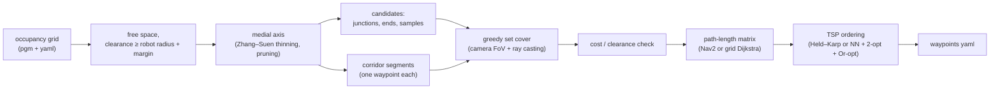
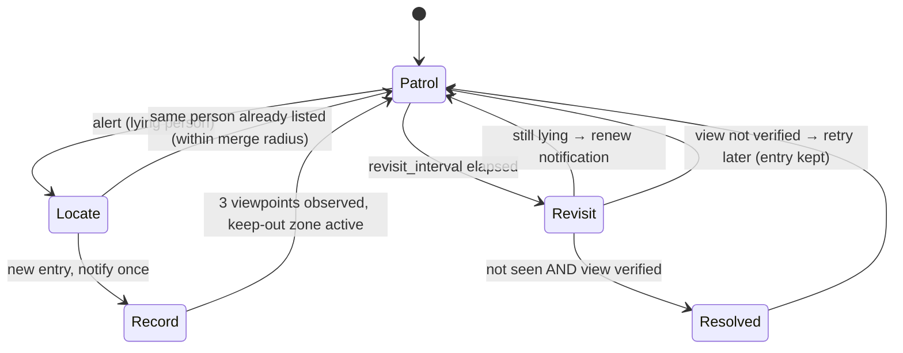

# Patrol planning and execution (`fsb_patrol`)

The patrol is generated from the occupancy grid alone; the code contains no world coordinates.
Inputs: a `map_server` yaml/pgm and `config/robot_params.yaml` (robot radius, safety margin, camera
FoV and range, costmap inflation). When the map changes, only the planner is re-run.

The steps below combine well-known methods. Nothing here is a new algorithm; the sections describe
**this project's implementation** and its parameters.



## 1. `patrol_planner`

| Step | Method | This project's implementation |
|---|---|---|
| Traversable space | Distance transform | Cells whose clearance ≥ circumscribed radius + safety margin; narrow bottlenecks removed, largest connected component kept. Small unknown islands (< `speckle_area`) count as free |
| Skeleton | Medial axis / grid approximation of the generalised Voronoi diagram | Zhang–Suen thinning, branches shorter than `prune_length` pruned. Junctions, end points and points every `sample_step` become candidates |
| Corridors | — | Narrow skeleton segments outside junction discs and longer than `corridor_min_length`; each must contain a waypoint so that the robot actually enters rack aisles |
| Viewpoint selection | Art-gallery style viewpoint coverage solved as **set cover** with the lazy greedy approximation | Each candidate × `yaw_sectors` headings; visibility = camera FoV + range + ray casting on the grid. Greedy until `target_coverage` (95 %), then redundant viewpoints are removed. Yaw = sector facing the most uncovered area |
| Validation | Inflation-layer cost | Cost ≤ `max_waypoint_cost`, also checked against the live global costmap when Nav2 is up |
| Distance matrix | Shortest paths | Nav2 `compute_path_to_pose` path lengths (`--cost nav2`) or grid Dijkstra (`--cost grid`, no Nav2) |
| Ordering | **Travelling salesman problem** | n ≤ 12: Held–Karp (exact); otherwise multi-start nearest neighbour + 2-opt + Or-opt |

Only apt packages are used (numpy, scipy, PyYAML, matplotlib). Thinning, pruning and the TSP
heuristics are written with numpy/scipy.

**Output** (`config/waypoints_factory.yaml`): map sha256 and path (relative), summary (coverage
total/narrow/wide, tour length, corridor segments), per waypoint `x, y, yaw`, type, clearance, cost,
and the `path_lengths_m` matrix used by the executor.

```bash
ros2 run fsb_patrol patrol_planner --cost grid --map src/fsb_navigation/maps/factory.yaml \
    --out /tmp/wp.yaml --png /tmp/wp.png
# exit code 2 if coverage is below target
```

### Results on the factory map (20 × 14 m)

| Metric | Value |
|---|---|
| Waypoints | 29 |
| Planned coverage (total / narrow / wide) | 95.02 % / 93.7 % / 98.3 % |
| Corridor segments entered | 12 / 12 |
| Minimum waypoint clearance | 0.475 m |
| Tour length | 87.4 m (Nav2 costs); 88.3 m (grid costs) |
| Longest single leg | 23.5 m (≈ 118 s at 0.2 m/s; `goal_timeout` is 180 s) |

**Generalisation check** (`map_variants`, also run in `colcon test`): 7 cases — the original map,
rotated 90° and 30°, mirrored, two crops, and mirror + 17° rotation. Results: 12–31 waypoints,
95.02–95.65 % coverage, all waypoints valid and mutually reachable, all corridor segments entered.
These are synthetic transformations of one map, not independent environments.

## 2. `patrol_executor`

Sends one `NavigateToPose` goal at a time.

| Mode | Next target |
|---|---|
| `idleness` (default) | argmax of `weight · time since last visit − estimated travel time` (`path_lengths_m / nominal_speed`) |
| `sequential` | TSP order |
| `random` | uniform |

Idleness-based selection is a standard approach in multi-/single-robot patrolling literature; here
it is a single-robot greedy rule. Unreachable or timed-out goals (`goal_timeout`, 180 sim-s) are
skipped and logged; the loop continues. Priority points with higher weights are read from a separate
yaml. `/patrol/waypoints` (`MarkerArray`) colours targets by state in RViz.

### Incident handling (lying person)
Triggered by `/security/alerts` from `fsb_perception` (see `docs/PERCEPTION.md`).



1. **Locate:** LiDAR points inside the detection box's bearing range; the nearest connected cluster
   (neighbour gap ≤ 0.3 m) gives the map position and the visible body extent. Fallback: ground-plane
   ray from the box bottom edge (unreliable with a 4.7 cm camera, used only without LiDAR points).
2. **Merge:** a detection within `merge_radius` (1 m) of an entry's centre **or body points** is the
   same person (a 1.7 m body otherwise produced two entries: 3 duplicates in 9 people before this
   change). Detections farther than 6.5 m do not create entries (box–LiDAR association error up to
   2.7 m at 10 m).
3. **Record:** the current patrol goal is cancelled; `inspect_views` (3) viewpoints at 2 m, ≥ 50°
   apart, low cost and with a LiDAR line of sight, are visited; frames and posture data are stored;
   the position is refined with the median of observations.
4. **Keep-out:** while an entry is active, a 1 m disc around the person is published to the Nav2
   obstacle layer (`/security/keepout`). Reason: the LiDAR plane (~11 cm) sees only part of a lying
   body; in one run the robot got stuck against the body while passing between the person and a rack.
5. **Revisit:** after `revisit_interval`, a viewpoint is visited. *Still lying* → notification
   renewed. *Resolved* only if all three hold: position inside camera FoV and ≤ 4 m, LiDAR line of
   sight clear, no LiDAR return at the position. Otherwise the entry is **kept** and retried.

Files (`alert_log_dir`, default `~/.ros/fsb_security`, outside the repository): `watchlist.yaml`
(written atomically, reloaded on restart), `events.jsonl`, annotated frames.

## 3. `coverage_monitor`

Uses the same visibility model as the planner on the robot's actual camera poses (TF
`map→camera_link`) and reports the fraction of free space actually seen, narrow-area coverage and
corridors entered.

## Measured results (simulation)

| Test | Result |
|---|---|
| 5-loop idleness patrol (0.22 m/s) | 5/5 loops, 156 visits, 0 skipped, 0 recovery behaviours, 0 collisions (528 559 ground-truth samples), min clearance 10.5 cm, ~734 m |
| Coverage from the actual path (same run) | 99.95 % (narrow 99.94 %), 12/12 corridors |
| 4-point legacy patrol | 10/10 loops, 0 recoveries |
| Lying-person capture (4 worlds × 3 people) | 12/12 found, 1 duplicate entry, position error median 0.28 → 0.23 m after recording (max 0.80 → 0.65 m) |

## Known limitations
- Coverage is a 2D visibility model on the occupancy grid (camera height and occlusion by objects
  not in the map are ignored).
- Greedy set cover and the TSP heuristics are approximations; no optimality claim for n > 12.
- The idleness rule is greedy and single-robot.
- The lying-person merge radius is a fixed distance; one duplicate entry occurred when the LiDAR
  cluster slid to a rack edge behind the person (1.16 m error).
- Sample sizes for incident handling are small (4 worlds × 1 loop plus flow tests).
