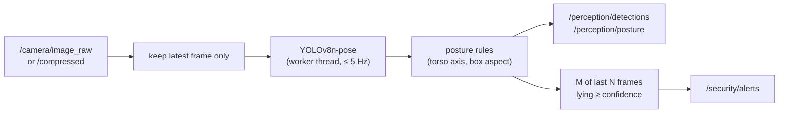

# Perception (`fsb_perception`)

`yolo_node` detects people with **YOLOv8n-pose** (Ultralytics, AGPL-3.0) and classifies each
person's posture with simple geometric rules. A security alert is raised **only for a person lying
on the floor**; standing/walking people and other objects never raise alerts. The patrol reaction
(localisation, recording, revisit) lives in `fsb_patrol` (see `docs/PATROL_PLANNER.md`).

## Posture rules (`fsb_perception/posture.py`)
Pure function, unit-tested without ROS.

| Order | Condition | Decision |
|---|---|---|
| 1 | Shoulder and hip keypoints ≥ `kp_conf` (0.5) and torso axis (mid-shoulder → mid-hip) ≥ 45° from vertical | lying (`torso`) |
| 2 | Torso valid, ≤ 30° from vertical and box aspect < 1.5 | upright |
| 3 | Box width/height ≥ 1.5 | lying (`aspect`, fallback) |
| 4 | otherwise | unknown |

**Temporal confirmation:** alert when at least M = 4 of the last N = 10 inferences contain a lying
person above `alert_confidence` (0.35); repeated every 2 s while the condition holds.

Thresholds were placed between the measured feature distributions: lying people had a median box
aspect of 2.75 (p5 0.87) and median torso angle 83°; upright people had a median aspect of 0.47
(p95 1.17) and torso angle ≤ 4°.

## Runtime design
- Inference runs in a separate thread at most `rate` Hz and only on new frames; the image callback
  stores just the latest frame, so the executor is never blocked and frames do not queue up.
- The node depends only on the image topic (no TF, no Nav2), so it can run on another machine with
  `image_transport:=compressed`.
- Python environment: torch and ultralytics live in a separate venv **without** `opencv-python`; the
  node starts with `PYTHONNOUSERSITE=1` so the apt OpenCV 4.6 used by `cv_bridge` is not shadowed by
  a pip OpenCV in `~/.local`. Set up with `scripts/setup_perception_venv.sh`.

## Measured results (simulation, Gazebo Fuel human models)

| Measurement | Result | Sample |
|---|---|---|
| Inference rate (yolov8n-pose, 640×480, CUDA) | ~5.4 Hz (5.2–5.4 Hz from compressed input) | — |
| Walking person seen during patrol, confidence ≥ 0.8 | 95.1 % of frames (median 0.891) | 453 frames |
| Lying-person capture | 12/12 people found, 1 duplicate entry | 4 worlds × 3 people, 1 loop each |
| First-alert range | 1.7–6.3 m (median 5.75 m) | 12 people |
| Negative test (standing person + box, full loop) | 0 lying decisions, **0 alerts** | 4525 inferences, 471 frames with a person |
| Fixed-scene false "lying" | standing people 0/512, boxes 0/192 frames | — |
| Single-frame "lying" decision vs. camera height | 4.7 cm: 55.0 % · 30 cm: 58.6 % · 60 cm: 66.8 % | 2464 frames: 4 models × 3 lying poses × 4 distances × 5 headings |
| Simulation real-time factor with perception + patrol (CUDA) | RTF 0.944 (raw images) / 0.910 (compressed images + watchdog, 3 lying people) vs. 0.951 without perception; YOLOv8n-pose process 72 % of one core, GPU 27 % | 240 s each, 16-core machine |

Weak cases at the current 4.7 cm camera height: body pointing along the viewing direction (head or
feet towards the camera, 30–33 %), 6 m distance (25 %), very close where the body does not fit the
frame (1.5 m: 37 %), side-lying (32 %). Per model: Standing person 17 %, Walking person 51 %,
Casual female 57 %, Rescue Randy 68 %. The system relies on accumulating frames while approaching
(M of N) and on multi-view recording rather than on single frames.

## Known limitations
- All numbers come from four Gazebo Fuel human models in simulation; real people, clothing,
  lighting and camera noise are **not** validated.
- The simulated camera sits 4.7 cm above the floor (Andino geometry); a mounting height of
  ≥ 30–60 cm is recommended for the real robot (`docs/HARDWARE.md`).
- Rules are hand-tuned thresholds, not a trained posture classifier.
- Ultralytics is licensed under AGPL-3.0 and is not included in this repository. If you plan to
  distribute a system with this node or offer it as a network service, review the current licence
  terms (AGPL-3.0 or a commercial licence) yourself; this note is not legal advice
  (`ATTRIBUTIONS.md`).
